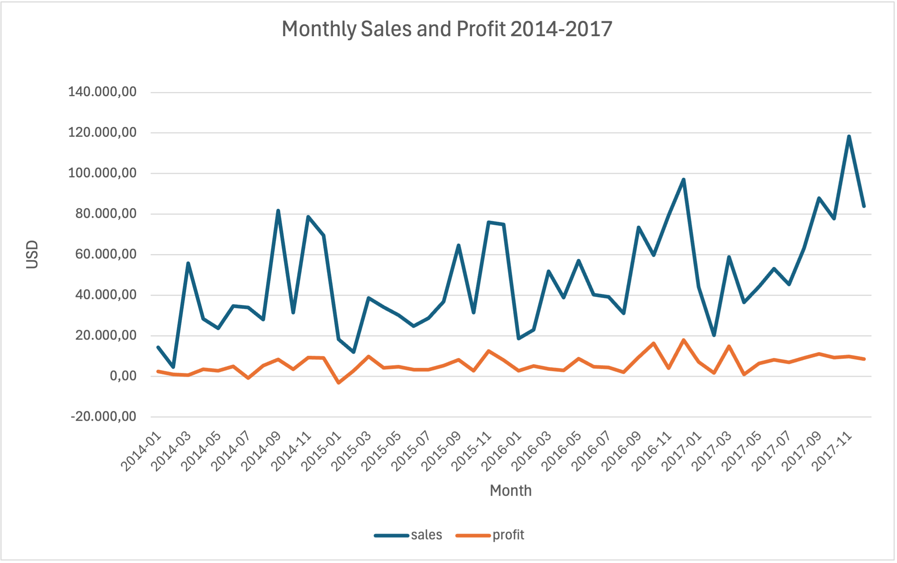
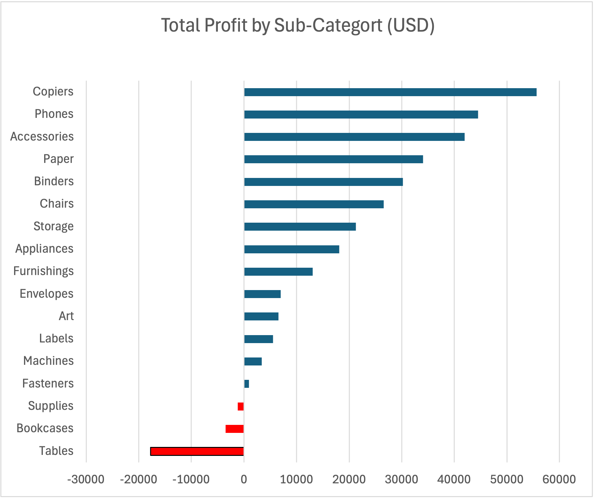
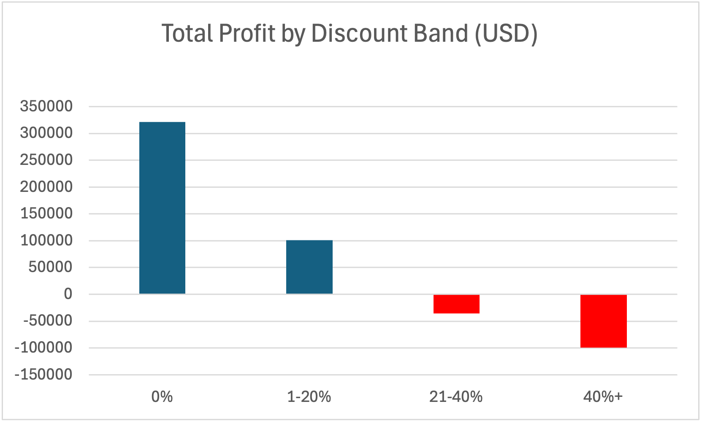

# Retail Sales Analysis | SQL, Excel

Analysis of 9,994 order lines from a US retail store (Superstore dataset, 2014-2017) to find which products, regions and discount levels drive profit and loss.

## Business Questions
1. Which categories and sub-categories make or lose money?
2. Which regions perform best and worst on profit?
3. How do discounts affect profit?
4. How have sales and profit changed over time?

## Dataset
- Source: Superstore Dataset (Kaggle)
- Size: 9,994 rows, covering orders from 2014 to 2017
- Key columns: Order Date, Region, Segment, Category, Sub-Category, Sales, Quantity, Discount, Profit

## Tools
- **SQL (SQLite, DB Browser):** data checks, cleaning and analysis
- **Excel:** charts and workbook

## Data Cleaning
Checked 9,994 rows: no missing values in Sales, Profit or Postal Code, no duplicate Row IDs, and consistent text in Region, Category and Segment. Order dates were stored as text (e.g. 11/8/2016), so I converted them to ISO format (2016-11-08) in a clean table, `orders_clean`, and set proper numeric data types.

## Key Findings
1. **Three sub-categories lose money.** Tables, Bookcases and Supplies were unprofitable. Tables alone lost $17.7K (margin -8.6%) despite $207K in sales, while Copiers earned the highest profit ($55.6K, 37.2% margin).
2. **Central is the weakest region.** West was the most profitable region ($108K profit, 14.9% margin). Central had the lowest margin (7.9%): it sold $501K but earned only $39.7K profit, less than South despite higher sales.
3. **Discounts above 20% are unprofitable.** Orders with 21-40% and 40%+ discounts lost $35.8K and $99.6K respectively, a combined loss of about $135K, while orders with no discount earned $321K profit.
4. **Strong growth.** Sales grew 51% from 2014 ($484K) to 2017 ($733K), and profit grew 89% ($49.5K to $93.4K). Profit margin rose from 10.2% to 13.4% by 2016, then dipped to 12.7% in 2017.
5. **Clear seasonality.** Sales peak every September to December (highest: November 2017, $118K) and are lowest in January and February. Only 2 of 48 months were unprofitable.

## Charts

### Monthly sales and profit

### Profit by sub-category

### Profit by discount band

## Recommendations
- Review pricing and costs for Tables and Bookcases, which lose money even at high sales volumes.
- Set a discount cap of about 20%, since higher discounts are associated with losses.
- Investigate why Central has a much lower margin than West and East.
- Plan stock and marketing around the September to December peak.

*Note: the analysis shows that high discounts and losses go together, but it does not prove that discounts alone caused the losses.*

## Repository Structure
- `data/` - raw orders dataset
- `sql/analysis.sql` - data checks, cleaning and all analysis queries
- `outputs/` - charts, Excel workbook and query results

## How to Reproduce
1. Import the orders CSV into SQLite as a table named `orders`.
2. Run the queries in `sql/analysis.sql` in order.
3. Open `outputs/retail_analysis.xlsx` to see the charts.
